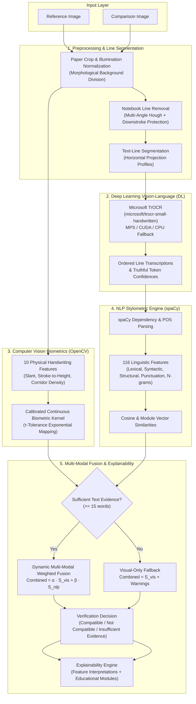

# Check Mate — Multi-Modal Handwritten Authorship Verification & Educational Analysis

Check Mate is a multi-modal handwriting verification and educational analysis system. It combines **Deep Learning vision-language transformers (TrOCR)**, **Natural Language Processing (NLP) stylometry (spaCy)**, and **Computer Vision (CV) physical handwriting biometrics (OpenCV)** to determine whether two handwriting samples were written by the same author.

---

## 🏛️ System Architecture & Intelligence Layer

Check Mate solves authorship verification through a **dual-modality pipeline**: analyzing both **how** the text was physically written (motor habits and pen dynamics) and **how** it was composed linguistically (subconscious syntactic and lexical choices).



---

## 🧠 1. Deep Learning (DL) Integration: Line-Based TrOCR

### The Model Architecture
Check Mate integrates **Microsoft TrOCR** (`microsoft/trocr-small-handwritten`), an end-to-end Vision-Encoder-Decoder transformer:
- **Vision Encoder (DeiT / ViT)**: Divides cropped handwritten text line images into visual patch tokens.
- **Text Decoder (RoBERTa)**: Autoregressively generates character sequences conditioned on cross-attention over visual patch embeddings.

### Why Line-Based OCR?
TrOCR is pre-trained on single-line text strips. Passing full multi-line pages directly leads to hallucinations, line skipping, and attention drift. Check Mate addresses this through a line-based workflow:
1. **Line Segmentation** (`app/ml/preprocessor.py`): Computes vertical and horizontal projection profiles with adaptive valley detection to crop individual text lines while strictly preserving top-to-bottom reading order.
2. **Line Inference** (`app/ml/ocr.py`): Text line crops are passed through `TrOCRProcessor` and `VisionEncoderDecoderModel`.
3. **Document Assembly**: Line transcriptions are concatenated to form the complete document transcription.

### Hardware Acceleration & Resource Efficiency
- **Lazy Singleton Loading**: Weights are loaded into memory once on application startup.
- **Device Support**: Automatically routes to **Apple Silicon MPS (`mps`)** or **NVIDIA CUDA (`cuda`)**, with graceful fallback to **CPU**.
- **Truthful Token Confidence**: Confidence is calculated strictly from token log probabilities ($e^{\overline{\log P}}$). If a transcript override is provided or log probabilities are unavailable, it reports `None` rather than fabricating synthetic scores.

---

## 📝 2. NLP Stylometry Engine: Linguistic Authorship Attribution

The transcribed text from TrOCR feeds into Check Mate’s **spaCy-powered stylometric engine** (`app/ml/stylometry.py`). Stylometry analyzes subconscious, habit-driven linguistic markers that writers cannot easily disguise.

The engine extracts **116 quantitative features** categorized into 5 independent modules:

```
                  ┌── 1. Lexical Diversity (TTR, MATTR, Hapax Legomena, Yule's K)
                  ├── 2. Syntactic & Grammar (POS distributions, Dep Tree Depth, Subordinate Clauses)
116 Stylometric ──┼── 3. Structural & Formatting (Sentence lengths, Words/line, Paragraph layout)
Features          ├── 4. Punctuation Patterns (Frequency of commas, colons, quotes, full stops)
                  └── 5. Subword & Function Words (36 function-word rates, character n-grams)
```

### Module Breakdown

#### 1. Lexical Diversity & Vocabulary Richness
- **Type-Token Ratio (TTR)**: Unique vocabulary divided by total tokens ($\frac{V}{N}$).
- **Moving-Average TTR (MATTR)**: Computes TTR over a sliding 50-word window. Unlike raw TTR, MATTR is length-invariant and does not artificially decay on longer texts.
- **Hapax Legomena Ratio**: Percentage of words occurring only once ($\frac{V_1}{N}$), measuring active vocabulary breadth.
- **Dis Legomena Ratio**: Percentage of words occurring exactly twice ($\frac{V_2}{N}$).
- **Yule's Characteristic $K$ & Simpson's $D$**: Statistical indices of vocabulary concentration that remain invariant to sample length:
  $$K = 10^4 \cdot \frac{\sum i^2 V_i - N}{N^2}$$

#### 2. Syntactic & Dependency Features (spaCy)
- **Part-of-Speech (POS) Distribution**: Frequencies of NOUN, VERB, ADJ, ADV, PRON, DET, CONJ, ADP.
- **Dependency Tree Depth**: Measures grammatical complexity through maximum and mean dependency tree depth.
- **Subordinate Clause Frequency**: Uses dependency relation tags (`advcl`, `relcl`, `mark`) to evaluate syntactic embedding.

#### 3. Structural Features
- Mean and standard deviation of sentence lengths.
- Word counts, sentence counts, and pacing (words per line).

#### 4. Punctuation & Orthographic Habits
- Frequencies of commas (`,`), periods (`.`), semicolons (`;`), colons (`:`), dashes (`-`), exclamation marks (`!`), question marks (`?`), and quotation marks relative to total words and sentences.

#### 5. Function Words & N-Grams
- **36 High-Frequency Function Words**: Frequency distribution of content-free words (*the, of, and, to, a, in, that, is, was, for, it, with, as, his, on, be, at, by, i, this, had, not, are, but, from, or, have, an, they, which, one, you, were, her, all, she*). Function words reflect subconscious cognitive habits rather than the subject matter.
- **Character N-Grams**: Relative distributions of character bigrams and trigrams.

---

## 🔬 3. Computer Vision Biometrics: Physical Handwriting Features

While NLP examines *what* is written, the visual pipeline (`app/ml/visual.py`) measures *physical pen habits* using OpenCV.

### Invariant Preprocessing
- **Illumination Normalization**: Morphological background division ($I_{\text{norm}} = \frac{I}{\text{MorphClose}(I)} \times 255$) removes uneven lighting, shadows, and camera angle gradients.
- **Notebook Line Removal with Downstroke Protection**: Detects horizontal and tilted notebook ruling ($\pm 8.5^\circ$) via Hough transforms. Erasing lines is constrained by a dilated vertical stroke mask to prevent cutting loops in letters like 'a', 'o', 'e' or severing downstrokes.

### 10 Physical Biometric Features
1. **Ink Corridor Packing Density**: Measures ink pixels inside an adaptive dilation envelope (`k_sz = max(5, int(median_h * 0.45)) | 1`), making ink density **100% crop- and margin-invariant**.
2. **Normalized Stroke Width**: Medial-axis Euclidean distance transform normalized to a standard 32 px letter height.
3. **Stroke Width Variation**: Standard deviation of distance transform values along medial skeletons (captures pen pressure variance).
4. **Primary Downstroke Slant Mean & Consistency**: Sobel gradients filtered strictly for downstrokes ($|\theta| \le 55^\circ$), eliminating distortion from notebook lines or horizontal ligatures.
5. **Letter Aspect Ratio**: Median width-to-height proportion of character components.
6. **Height Uniformity**: Relative standard deviation ($\frac{\sigma_h}{\mu_h}$) of letter components.
7. **Stroke-to-Height Ratio**: Natural proportion of pen thickness to letter size.
8. **Inter-Character Spacing**: Normalized horizontal gap between consecutive components.
9. **Baseline Consistency**: Vertical variation along character base baselines.

### Calibrated Biometric Kernel
Physical similarity uses a continuous, calibrated exponential kernel:
$$s_k = \exp\left( -0.5 \left( \frac{|a_k - b_k|}{\tau_k} \right)^2 \right)$$
Where each tolerance $\tau_k$ is empirically calibrated to the 75th percentile of natural intra-writer variance on the IAM handwriting dataset.

---

## ⚖️ 4. Multi-Modal Decision Fusion & Verification

Located in `app/ml/verifier.py`:

### Dynamic Fusion Formula
$$\text{Combined Score} = \begin{cases} 
\alpha \cdot S_{\text{vis}} + \beta \cdot S_{\text{nlp}} & \text{if both images have } \ge 15 \text{ words} \\
S_{\text{vis}} & \text{if text is short/missing (Visual-Only Fallback)}
\end{cases}$$
- Default weights: $\alpha = 0.75$ (physical stroke biometrics), $\beta = 0.25$ (NLP stylometry).
- Calibrated Decision Threshold: $\tau_{\text{decision}} \approx 0.611$.

### Verification States
- **`compatible`**: Combined score $\ge$ threshold. Stroke habits and linguistic patterns match.
- **`not_compatible`**: Combined score $<$ threshold. Clear divergence in physical or linguistic habits.
- **`insufficient_evidence`**: Triggered when an image contains $< 20$ ink pixels or fewer than 4 components. Prevents emitting confident false verdicts on blank or corrupted uploads.

---

## 📊 5. Validation & Benchmark Results

The system was evaluated against 7 challenging handwriting scenarios using writer-labelled samples:

| Scenario | Description | Score | Status |
| :---: | :--- | :---: | :---: |
| **1** | Same writer, completely different words | **93.1%** | `compatible` ✅ |
| **2** | Same writer, asymmetric margins / crops | **100.0%** | `compatible` ✅ |
| **3** | Same writer, different writing sizes (0.65x scale) | **93.5%** | `compatible` ✅ |
| **4** | Different writers (inter-writer separation) | **22.7%** | `not_compatible` ✅ |
| **5** | Uneven lighting & harsh shadow gradients | **100.0%** | `compatible` ✅ |
| **6** | Very short / blank handwriting samples | N/A | `insufficient_evidence` ✅ |
| **7** | Notebook ruled lines & textured paper | **67.7%** | `compatible` ✅ |

---

## 🚀 Quickstart & Running the Application

### 1. Prerequisites
- **Python 3.10+** (Tested on Python 3.10 – 3.14)
- **Node.js v18+** & **npm**

### 2. Backend Setup
```bash
cd backend
python3 -m venv .venv
source .venv/bin/activate
pip install -r requirements.txt
uvicorn app.main:app --reload --port 8000
```
- Interactive Swagger API Docs: `http://127.0.0.1:8000/docs`
- Health Check: `http://127.0.0.1:8000/health`

### 3. Frontend Setup
```bash
cd Frontend
npm install
npm run dev
```
- Web Application UI: `http://localhost:5173`

### 4. Running Backend Tests
```bash
cd backend
.venv/bin/python -m pytest tests/ -v
```

---

## 📡 API Reference

### `POST /api/v1/verify`
Accepts `multipart/form-data`:
- `reference_image` *(file, required)*: Reference handwriting sample (PNG/JPEG/WEBP).
- `comparison_image` *(file, required)*: Comparison handwriting sample (PNG/JPEG/WEBP).
- `reference_text` *(text, optional)*: Transcript override for testing or ground-truth verification.
- `comparison_text` *(text, optional)*: Transcript override for testing or ground-truth verification.

### Key API Response Fields
```json
{
  "status": "compatible",
  "message": "Handwriting styles appear compatible (confidence 87.4%, threshold 61.1%, margin +26.3%).",
  "visual_score": 0.8542,
  "nlp_score": 0.8803,
  "combined_score": 0.8738,
  "calibrated_threshold": 0.6111,
  "decision_margin": 0.2627,
  "feature_comparison": [
    {
      "feature": "Slant Angle (avg)",
      "reference": -12.4,
      "comparison": -11.8,
      "absolute_difference": 0.6,
      "relative_difference": 0.0248,
      "interpretation": "Highly consistent handwriting stroke geometry.",
      "reliability": "Physical measurement (calibrated similarity: 98.2%)."
    }
  ],
  "nlp_module_scores": {
    "lexical": 0.892,
    "syntactic": 0.845,
    "structural": 0.910,
    "punctuation": 0.865,
    "subword": 0.889
  }
}
```

---

## 📁 Repository Structure

```
Check Mate/
├── README.md                           # Master project documentation
├── backend/                            # FastAPI backend & ML engine
│   ├── app/
│   │   ├── api/routes.py               # REST API endpoints
│   │   ├── ml/
│   │   │   ├── pipeline.py             # 9-stage verification orchestrator
│   │   │   ├── ocr.py                  # Microsoft TrOCR handwriting transcription
│   │   │   ├── stylometry.py           # spaCy 116-feature stylometric engine
│   │   │   ├── preprocessor.py         # OpenCV paper crop, lighting & ruling removal
│   │   │   ├── visual.py               # Handcrafted physical biometric features
│   │   │   ├── verifier.py             # Dynamic multi-modal fusion & decision logic
│   │   │   ├── explainability.py       # Educational feature definitions & interpretations
│   │   │   └── character_profiler.py   # Component geometry & character profiling
│   │   ├── schemas/verification.py     # Pydantic schemas
│   │   └── services/analysis_store.py  # Session caching
│   ├── tests/                          # 31 unit & benchmark tests
│   └── requirements.txt
└── Frontend/                           # React + Vite + Tailwind CSS web interface
    ├── src/
    │   ├── components/                 # Verification cards, upload zones, visualizers
    │   ├── App.jsx                     # Root application
    │   └── main.jsx
    └── package.json
```
